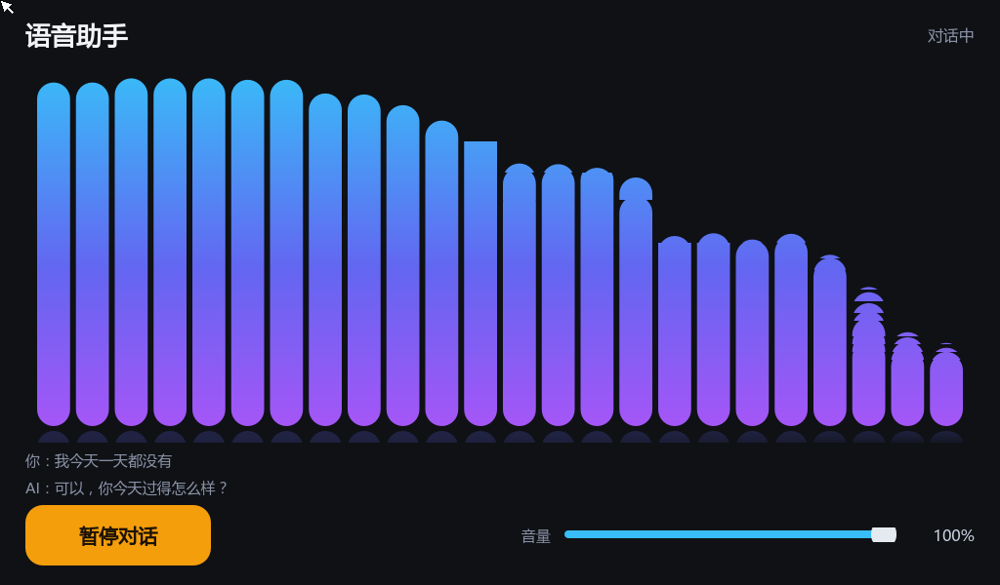

# voice_assistant_qt — 语音助手 Qt 界面

给 `voice_assistant`（豆包端到端实时语音全双工）套一个板端 Qt 界面：

- **开始 / 暂停对话**按钮（绿色开始、橙色暂停）
- **音量滑块**（0-100，实时调节 PulseAudio sink 音量）
- **对话音频频谱动效**（FFT 频域柱状图，麦克风与助手声音都会驱动）
- 实时显示识别文本与助手回复



> 本仓库是独立项目，依赖 `voice_assistant` 主项目部署在板子的 `/root/voice_assistant/`
> （Python 后端 + 云端协议都在那边；本仓库只负责 UI 与进程/音频/FFT）。

## 1. 工作原理

```
┌──────────────────── 板子 ────────────────────┐
│  VoiceAssistantQt (C++/Qt Widgets)           │
│    ├─ QProcess ──> python3 voice_assistant.py --spectrum
│    │                  │ stdout: @AUDIO M/T <base64 PCM>
│    │                  ├─ arecord 采集 ──> 豆包实时语音（云端）
│    │                  └─ paplay 播放 <── TTS 音频
│    ├─ SpectrumWidget：C++ FFT(256) → 24 段对数频段柱状图
│    └─ 音量：pactl（list sinks 解析当前值 / set-sink-volume 调节）
└──────────────────────────────────────────────┘
```

- **按钮**：启动 = `QProcess` 拉起 Python 助手；暂停 = `SIGTERM`（助手会清理会话与 arecord）
- **频谱**：Python 把麦克风（16k）与 TTS（24k）PCM 以 base64 行输出（`@AUDIO M/T`），
  Qt 侧做 256 点 FFT + Hann 窗，映射到 24 段对数频段（80Hz~7kHz），带平滑衰减与倒影
- **音量**：滑块拖动防抖 150ms 后 `pactl set-sink-volume @DEFAULT_SINK@ N%`
  （板子的 pactl 版本较老，没有 `get-sink-volume`，读取用 `pactl list sinks` 解析）
- **触摸**：沿用 photo_album 的适配（禁用 libinput、按 `ABS_MT_POSITION_X/Y` 找设备、`EVIOCSABS` 修正坐标范围）

## 2. 依赖

| 依赖 | 说明 |
| --- | --- |
| `voice_assistant` 项目 | 部署在板子 `/root/voice_assistant/`，含 `voice_assistant.py` 与 `config.ini`（真实凭证） |
| Qt 5.12（交叉编译） | `/home/book/100ask_imx6ull-sdk/Buildroot_2020.02.x/output/host/bin/qmake` |
| 板端 | Qt5 Widgets 运行库、`python3`、`pactl`、`/usr/lib/fonts/msyh.ttc`（中文字体） |

> 板子上的 `voice_assistant` 若是开机自启（`/etc/init.d/S99voiceassistant`），
> 运行本 UI 前请先 `S99voiceassistant stop`，否则两者会抢麦克风。

## 3. 构建

```sh
mkdir -p ../build-voice_assistant_qt-100ask_imx6ull-Debug
cd ../build-voice_assistant_qt-100ask_imx6ull-Debug
/home/book/100ask_imx6ull-sdk/Buildroot_2020.02.x/output/host/bin/qmake ../voice_assistant_qt/voice_assistant_qt.pro CONFIG+=debug
make -j4
```

## 4. 部署与运行

```sh
scp VoiceAssistantQt root@192.168.1.14:/root/
ssh root@192.168.1.14 '/etc/init.d/S99voiceassistant stop'   # 避免抢麦克风
ssh root@192.168.1.14 'cd /root && nohup env QT_QPA_PLATFORM=linuxfb:fb=/dev/fb0 \
    QT_QPA_FONTDIR=/usr/lib/fonts ./VoiceAssistantQt >/tmp/vaqt.log 2>&1 &'
```

打开界面 → 点「开始对话」→ 直接说话。

### 环境变量

| 变量 | 默认 | 说明 |
| --- | --- | --- |
| `VOICE_ASSISTANT_SCRIPT` | `/root/voice_assistant/voice_assistant.py` | Python 助手路径 |
| `VOICE_ASSISTANT_DIR` | `/root/voice_assistant` | Python 助手工作目录（读 `config.ini`） |
| `VOICE_QT_AUTOSTART` | 未设置 | `1` = 启动即自动开始对话（无人值守调试用） |
| `QT_QPA_PLATFORM` | — | 板子上必须为 `linuxfb:fb=/dev/fb0` |
| `QT_QPA_FONTDIR` | — | 板子上为 `/usr/lib/fonts`（中文字体） |

## 5. 自检

```sh
# 界面是否渲染（截板端 framebuffer）
ssh root@192.168.1.14 'dd if=/dev/fb0 bs=4096 count=600' > fb.raw
convert -size 1024x600 -depth 8 bgra:fb.raw fb.png

# 频谱动效测试源（不占用麦克风/云端）：正弦扫频冒充 TTS 音频
scp docs/spectrum_feed.py root@192.168.1.14:/tmp/
ssh root@192.168.1.14 'cd /root && kill $(pidof VoiceAssistantQt); \
    setsid env QT_QPA_PLATFORM=linuxfb:fb=/dev/fb0 QT_QPA_FONTDIR=/usr/lib/fonts \
    VOICE_QT_AUTOSTART=1 VOICE_ASSISTANT_SCRIPT=/tmp/spectrum_feed.py VOICE_ASSISTANT_DIR=/tmp \
    ./VoiceAssistantQt >/tmp/vaqt.log 2>&1 &'
```

## 6. 常见问题

| 症状 | 原因 | 解决 |
| --- | --- | --- |
| 界面不显示 / 中文字乱码 | 缺 `QT_QPA_PLATFORM` 或字体目录 | 按第 4 节命令带全环境变量 |
| 音量显示 `--%` | 板子 pactl 太老，无 `get-sink-volume` | 代码已改为从 `pactl list sinks` 解析（勿改回） |
| 点开始后没反应 | 麦克风被另一个助手实例占用 | `S99voiceassistant stop`，并确认没有残留 `arecord` |
| 频谱不动 | Python 未以 `--spectrum` 运行或解析失败 | 看 `/tmp/vaqt.log`；本 UI 已兼容 `@AUDIO` 行与文本粘连的情况 |
| 助手没声音 | PulseAudio 问题（auto_null / sink 挂起） | 参考主项目 README 第 7 章；主项目启动逻辑会自动修复 |

## 7. 文件结构

| 文件 | 说明 |
| --- | --- |
| `main.cpp` | 触摸/音频环境适配、深色主题、字体、全屏启动 |
| `mainwindow.h/cpp` | 布局、按钮/滑块逻辑、日志解析（识别文本/状态）、pactl 音量 |
| `spectrumwidget.h/cpp` | 接收 PCM、FFT、24 段频段、绘制动效 |
| `assistantprocess.h/cpp` | QProcess 管理 Python 助手，解析 `@AUDIO` 协议行 |
| `docs/spectrum_feed.py` | 频谱自测用的正弦扫频源（可选） |
